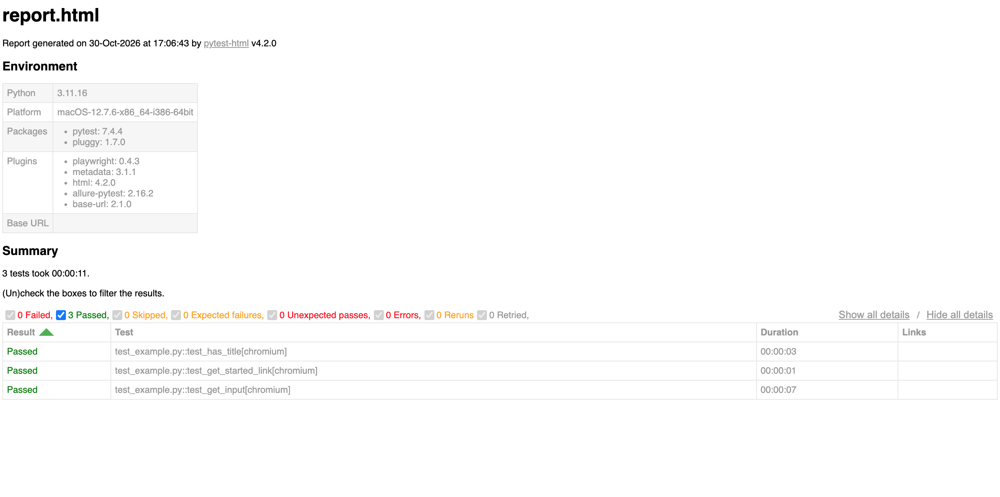
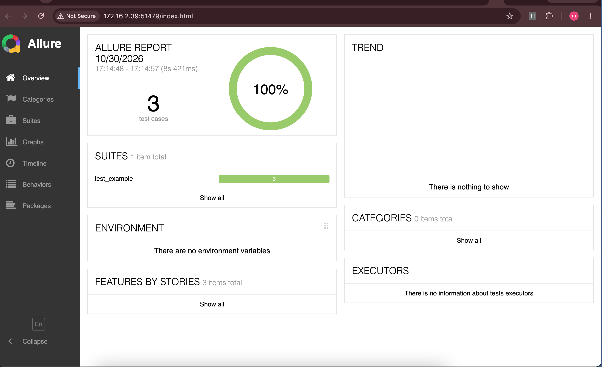
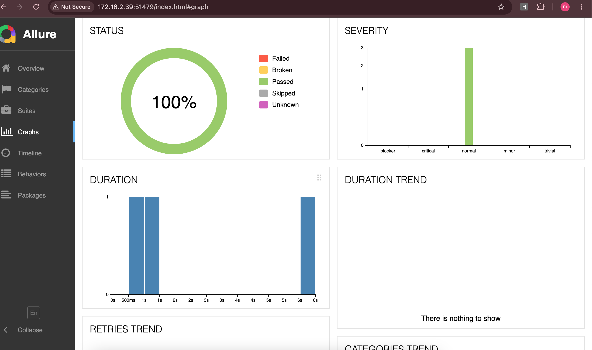
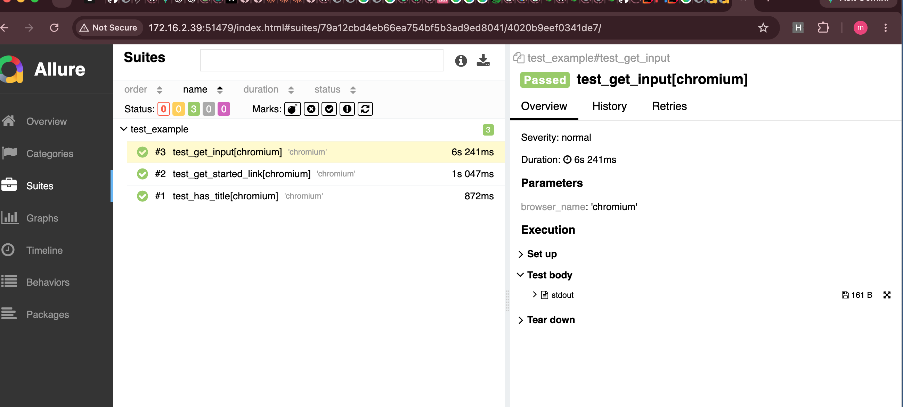

# Playwright Python Tests

A small Python test project using Playwright's synchronous API and pytest. The tests visit public websites, so a working internet connection is required.

## Project contents

- `test_example.py` contains the active Playwright tests for the Playwright documentation and the two-factor login demo.
- `test_login_cases.py` contains commented-out login test examples. Pytest will not collect tests from it until the examples are uncommented.
- `main.py` is a standalone script that opens the two-factor demo in a visible Chromium window and prints the page title and URL.
- `report.html` and `report.xml` are generated test reports. New test runs overwrite reports with the same filenames.
- `assets/style.css` styles the current HTML report.

## Setup

From the project directory, create and activate a virtual environment, install the project dependencies, and install the Chromium browser used by Playwright:

```bash
python3 -m venv .venv
source .venv/bin/activate
python -m pip install --upgrade pip
python -m pip install -r requirements.txt
python -m playwright install chromium
```

If your shell does not have the virtual environment activated, use `.venv/bin/python -m ...` in place of `python -m ...`.

The HTML report option requires `pytest-html`. It is used by the existing `report.html` but is not currently listed in `requirements.txt`; install it once in the virtual environment:

```bash
python -m pip install pytest-html
```

## Run tests

Run all collected tests in the default headless mode:

```bash
python -m pytest -v
```

Run the active test module, or an individual test:

```bash
python -m pytest test_example.py -v
python -m pytest test_example.py::test_get_input -v
```

Run tests with a visible browser window and show `print()` output in the terminal:

```bash
python -m pytest --headed -s
```

The test suite uses Chromium by default. To choose another Playwright browser, install it first with `python -m playwright install firefox` or `python -m playwright install webkit`, then run for example:

```bash
python -m pytest --browser firefox
```

## Generate reports

### HTML

The command previously used in this project was:

```bash
python -m pytest --headed -s --html=report.html
```

For a portable, self-contained HTML file that does not rely on the local `assets/style.css`, use:

```bash
python -m pytest --headed -s --html=report.html --self-contained-html
```


Open `report.html` in a browser to review the results.

### JUnit XML

Generate an XML report for CI systems and other test-reporting tools:

```bash
python -m pytest --junitxml=report.xml
```

### HTML and XML together

Generate both reports from the same run:

```bash
python -m pytest --headed -s --html=report.html --self-contained-html --junitxml=report.xml
```

### Allure

The `allure-pytest` plugin is included in `requirements.txt`. Save raw Allure results with:

```bash
python -m pytest --alluredir=allure-results
```

To open a rendered Allure report locally, install the separate Allure command-line tool, then run:

```bash
allure serve allure-results
```




## Run the standalone script

With the virtual environment active and Chromium installed:

```bash
python main.py
```

This opens a headed Chromium browser, visits the two-factor demo page, prints its title and URL, then closes the browser.


